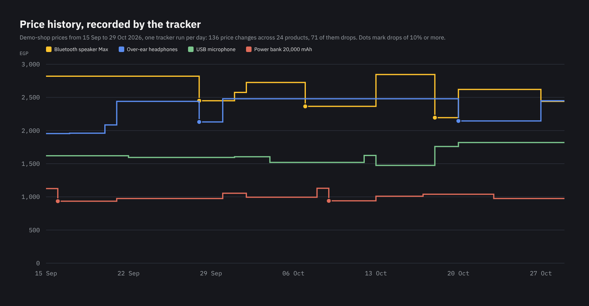
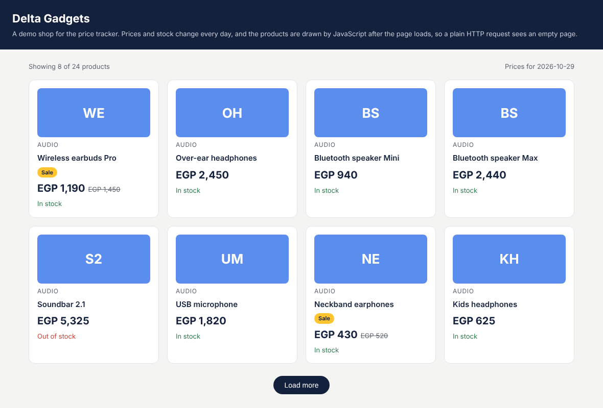
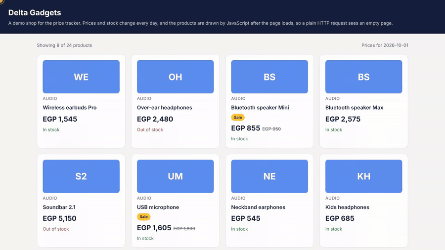

# Dynamic Price Tracker

[](../../actions/workflows/track.yml)

Tracks prices on online shops that build their pages with JavaScript, every day, and reports what changed:
price drops and rises, new and removed products, and stock going out or coming back.



## The problem

Many shops draw their product lists with JavaScript and hide most products behind a "Load more" button. A simple
scraper (requests + BeautifulSoup) downloads the page and finds no products at all. Checking competitors' prices
by hand every day is slow, and the changes that matter are easy to miss.

## What it does

| Step | What happens |
|---|---|
| Open | Loads the page in a real headless Chromium browser (Playwright), so the JavaScript runs as it would for a visitor |
| Load everything | Clicks "Load more" until every product is on the page, and stops safely if the button never goes away |
| Read | Name, category, price and stock for every product |
| Compare | Against the previous run: price drops and rises with the %, new and removed products, out of stock and back in stock |
| Record | `data/latest.csv`, `data/history.csv` (one row per product per day) and a readable `data/changes.md` |
| Repeat | GitHub Actions runs it every morning and commits the results, with no server to run |

Drops of 10% or more are marked as **deals** in the report.

## The demo shop

To keep the demo legal and stable, the tracker points at a small demo shop in [`shop/`](shop/): 24 gadgets, 8 per
page behind "Load more", drawn by JavaScript after a short delay, like a real shop calling its API. Prices and stock
change on some days, as they do in a real shop.



A plain HTTP request gets the page without a single product: the HTML only has an empty `<div id="products">`.
The tracker sees all 24.

## Run it

```bash
pip install -r requirements.txt
python -m playwright install chromium
python tracker.py                       # today's prices from the demo shop
python tracker.py --date 2026-10-01     # the demo shop as it was on that day
```



## Results so far

The demo shop can show any past day, so the history starts on 15 September 2026: the tracker was run once for each
day up to 29 October, and GitHub Actions adds a new day every morning from then on. The full record is in
[`data/history.csv`](data/history.csv).

Over those first 45 days it recorded 136 price changes across the 24 products. 71 of them were drops, and 25 of
those were 10% or more. It also recorded 28 stock changes. The latest report is in [`data/changes.md`](data/changes.md).

## Tracking a real shop

1. Change the CSS selectors in `SELECTORS` at the top of [`tracker.py`](tracker.py) to match the shop's page.
2. Run `python tracker.py --url https://shop.example.com/products`.
3. To run it every day, change the last step of [`.github/workflows/track.yml`](.github/workflows/track.yml) to
   pass the same `--url`.

Before tracking a site, read its terms of use and `robots.txt`, and keep the request rate low. Once a day is plenty
for price tracking.

## Tests

```bash
pytest
```

The tests check price parsing, every kind of change and the report. With a browser installed, they also open the
demo shop and check that all 24 products behind "Load more" are read, that a re-run on the same day replaces the day
instead of duplicating it, and that a "Load more" button that never disappears doesn't hang the tracker.

## Built with

Python · Playwright (headless Chromium) · GitHub Actions · HTML and JavaScript (demo shop) · pytest

## Need prices or stock tracked?

I build trackers like this for clients: competitor prices, marketplace listings or stock levels, checked on a
schedule, with a report or an alert when something changes. Tell me which sites and what you want to watch.

<a href="https://www.upwork.com/freelancers/~01b6c711b0162ca691"></a>
<a href="mailto:mazen.elnaghy@gmail.com"></a>

Built by [Mazen Elnaghy](https://github.com/mazenelnaghy-code) · [Portfolio](https://mazenelnaghy-code.github.io)
